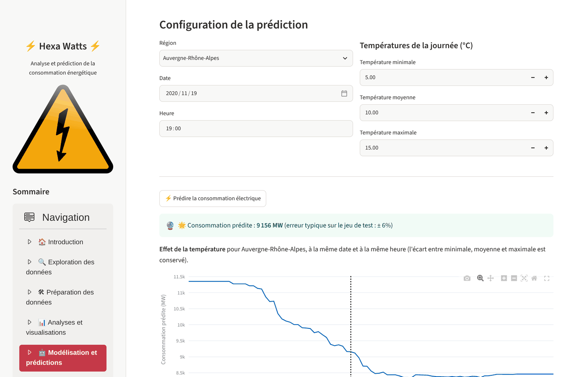

# Hexa Watts: Regional Electricity Demand in France

[](https://hexa-watt.streamlit.app/)
[](https://github.com/cnoret/hexa-watts/actions/workflows/tests.yml)


**How weather drives electricity demand** in the twelve regions of mainland France: production mix, renewables, exchanges between regions, and a gradient boosting model that forecasts regional consumption within **5.5 %** on twelve months it never saw (7.3 % for a naive baseline). Delivered as an interactive Streamlit app, in French.

**Data:** 1,893,312 half-hourly records · 12 regions · Jan 2013 – Dec 2021 · about 470 TWh consumed a year · 3 open data sources (RTE, Météo-France, Eurostat)

**Live app:** [hexa-watt.streamlit.app](https://hexa-watt.streamlit.app/)



---

## What's inside

The app has seven pages, each with its own URL (for example `/analyses`), reached from the sidebar. Each page opens with its key figures, and the Analyses page is split into tabs (Production, Load factors, Consumption, Regional exchanges, Europe). On the Analyses page, sidebar filters narrow the period and highlight one region in every regional chart; each chart title states its takeaway, with key points below and the full comment one click away.

| Page | Content |
| --- | --- |
| Introduction | Context and questions of the study |
| Exploration des données | Overview of the eco2mix and temperature datasets, fill rate of every column |
| Préparation des données | How the raw data was cleaned and reshaped |
| Analyses et visualisations | Key figures, then production mix, renewables by region, load and coverage factors, regional exchanges with a map by year, daily consumption profile, European comparison (Eurostat). Energy is shown in TWh. |
| Modélisation et prédictions | Consumption forecast for a region, date, time and temperatures, with the model's test metrics, a temperature curve and a week of predictions against actual consumption |
| Conclusion | Takeaways and challenges for 2050 |
| Ressources | Data sources and tools |

## Prediction model

- **Model:** `HistGradientBoostingRegressor` (scikit-learn) in a pipeline that encodes the region.
- **Inputs:** region, daily minimum, mean and maximum temperatures, time of day, day of week, public holidays, season (day of year as sine and cosine) and year. The features are built in `content/caracteristiques.py`, shared by the training script and the app.
- **Data:** half-hourly regional consumption (RTE eco2mix) joined with daily regional temperatures (Météo-France), January 2016 to October 2021.
- **Evaluation:** the model learns on data up to October 2020 and is tested on the following twelve months, which it never sees during training. The saved model is the one that was tested.

| Test period (Nov. 2020 to Oct. 2021) | Model | Naive baseline* |
| --- | --- | --- |
| Mean absolute error | 243 MW | 326 MW |
| RMSE | 357 MW | 491 MW |
| R² | 0.970 | 0.943 |
| Mean relative error | 5.5 % | 7.3 % |

\* Average consumption for the same region, month, day of week and time of day.

Years after 2020 are treated as 2020: the model does not extrapolate the trend from one year to the next.

To retrain (about 35 seconds), run `python scripts/entrainer_modele.py`. It rewrites `models/modele_consommation.joblib` and `models/metriques.json`, which the app reads. Retrain after any scikit-learn upgrade.

---

## Run it locally

The dependencies are pinned and tested with **Python 3.12**, the version used on Streamlit Community Cloud.

```bash
git clone https://github.com/cnoret/hexa-watts.git
cd hexa-watts
python3.12 -m venv venv
source venv/bin/activate  # On Windows: venv\Scripts\activate
pip install -r requirements.txt
streamlit run streamlit_app.py
```

## Tests and quality checks

```bash
pip install -r requirements-dev.txt
ruff check .
python -m pytest
```

The 56 tests (about 45 seconds) check that the seven pages run without exceptions, that each page has its own URL, that the Analyses filters work, that every option of the Analyses page renders, that the prediction works and reacts to temperature, and that the pinned dependencies install without conflicts.

GitHub Actions runs `pip check`, `ruff check` and the tests on every push and pull request (`.github/workflows/tests.yml`). The `main` branch only accepts pull requests whose tests pass. Dependabot proposes dependency updates once a month (`.github/dependabot.yml`).

---

## Deployment (Streamlit Community Cloud)

1. Sign in at [share.streamlit.io](https://share.streamlit.io) with the GitHub account that owns the repository.
2. Click **Create app**, then **Deploy a public app from GitHub**.
3. Repository `cnoret/hexa-watts`, branch `main`, main file path `streamlit_app.py`.
4. Open **Advanced settings** and select **Python 3.12**. This cannot be changed later without deleting and redeploying the app.
5. Click **Deploy**. The first build takes a few minutes. The data files (about 93 MB) are part of the repository, so nothing else needs to be uploaded.

The app stays under about 700 MB of RAM: the large Parquet files are aggregated on load and only small summary tables are cached.

---

## Project structure

```
hexa-watts/
├── content/                 # One module per page, the model features (caracteristiques.py) and shared UI helpers (interface.py)
├── datasets/                # eco2mix, temperatures, load factors, Eurostat data and region outlines (GeoJSON)
├── docs/                    # Screenshot for this README
├── images/                  # Images shown in the app
├── models/                  # Trained model and its test metrics
├── scripts/                 # Model training script
├── tests/                   # pytest and Streamlit AppTest
├── .github/                 # Tests workflow and Dependabot settings
├── .streamlit/config.toml   # Theme: colors, fonts and corner radius
├── streamlit_app.py         # Entry point and navigation
├── requirements.txt         # Pinned dependencies of the app
├── requirements-dev.txt     # Plus test and lint tools
└── ruff.toml                # Lint rules
```

## Data sources

| Source | Data | Period used |
| --- | --- | --- |
| [RTE eco2mix (ODRÉ)](https://odre.opendatasoft.com/explore/dataset/eco2mix-regional-cons-def) | Half-hourly regional consumption, production and exchanges | 2013 to 2021 |
| [Météo-France](https://donneespubliques.meteofrance.fr) | Daily regional temperatures | 2016 to October 2021 |
| [Eurostat](https://ec.europa.eu/eurostat) | Renewable energy balances by country | 2013 to 2021 |

## Built with

Python, Streamlit, pandas, PyArrow, Plotly, scikit-learn and joblib.

## Team

Originally a team project by Simon Berry, Siham Houchi and Christophe Noret, later reworked as Hexa Watts by [Christophe Noret](https://github.com/cnoret).

## License

MIT. See [LICENSE](LICENSE).
